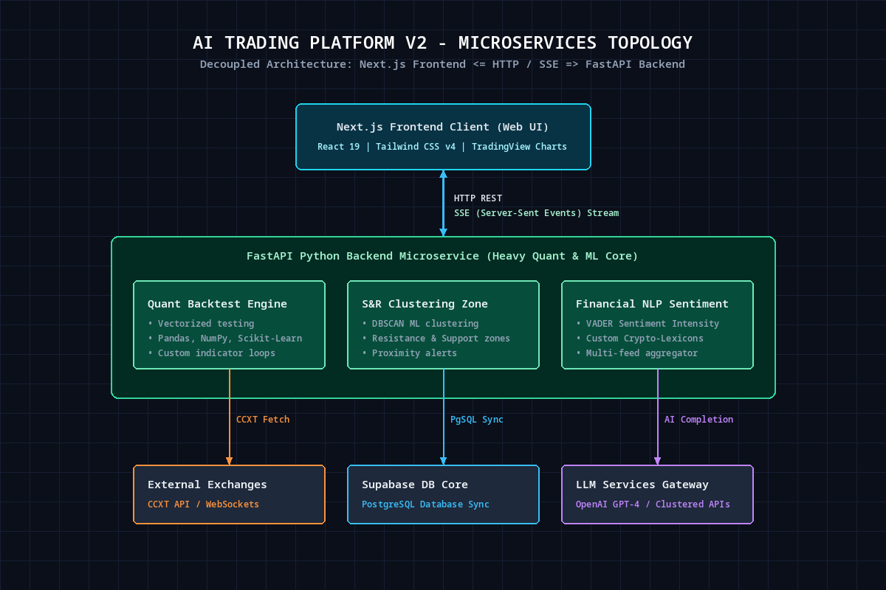

# 📈 AI Trading Platform

An institutional-grade, microservices-driven **AI-powered Quantitative Trading Platform** engineered with a high-performance **Python FastAPI Backend** and a modern, decoupled **Next.js Frontend**.

<p align="center">
  
  
  
  
  
  
  
</p>

---

## 🧱 Architecture

Below is the high-level system architecture of the platform, showing exchange connectivity, the background quant engines, the sentiment indexer, and the Next.js / FastAPI components.

| Full System Architecture |
| :---: |
|  |
| *Exchange Connectivity · Quant Engine · Sentiment Indexer · AI Canvas Overlay* |

---

## ✨ Key Features

| Area | Description |
|------|-------------|
| **Market Data Collection** | OHLCV candles, real-time prices, volume, order book, funding rates, open interest, liquidity, volatility — across multiple timeframes |
| **Quantitative Analysis** | Trend detection, support/resistance, breakout & momentum analysis, RSI, MACD, Moving Averages, Bollinger Bands, ATR, VWAP, supply/demand zones |
| **AI Market Analyst** | Trading signals (BUY / SELL / HOLD / WAIT) with detailed explanations, entry/stop/target levels, risk-to-reward ratio, and confidence scores |
| **News & Sentiment** | Crypto news aggregation, social media sentiment, regulatory updates, whale activity tracking — all fused into a sentiment index |
| **Performance Tracker** | Signal history tracking, win/loss ratio, ROI per strategy, continuous self-assessment and model improvement |

---

## 🛠️ Tech Stack & Directory Layout

Built using the **Feature-Folder Structure (FFS)**:

| Path | Stack | Description |
|------|-------|-------------|
| `frontend/` | Next.js 15+ · React 19 · Tailwind CSS v4 | Dashboard with AI Canvas overlay and lightweight-charts |
| `backend/` | FastAPI · Python 3.12+ · Pydantic v2 | Calculations, LLM streaming, exchange connectivity |
| `docs/` | — | System architecture blueprints and specifications |

---

## 🐳 Quick Start

1. Copy env files:
   ```bash
   cp backend/.env.example backend/.env
   cp frontend/.env.example frontend/.env
   ```

2. Run with Docker Compose:
   ```bash
   docker compose up --build
   ```

---

## 📄 License

This project is private and not licensed for redistribution.
