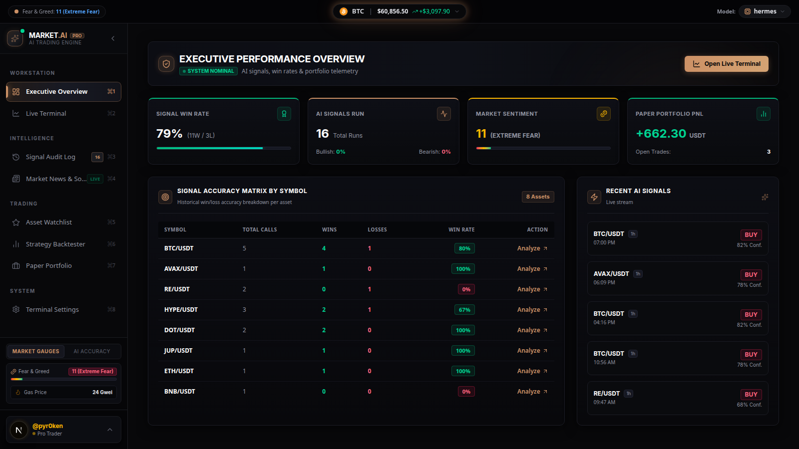
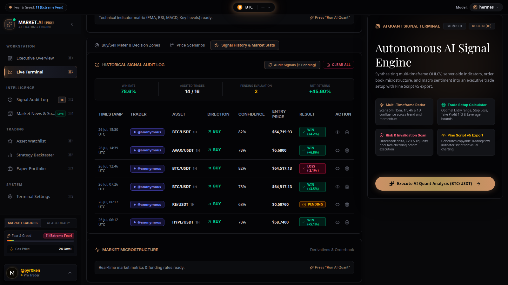
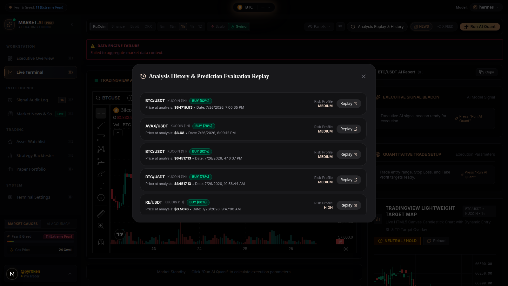
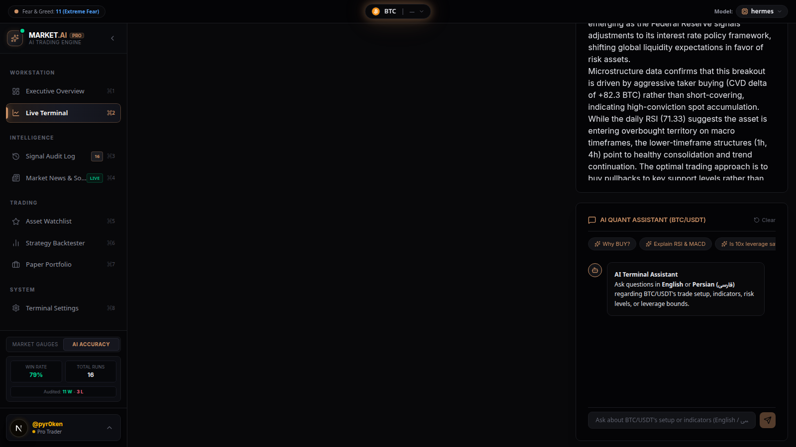
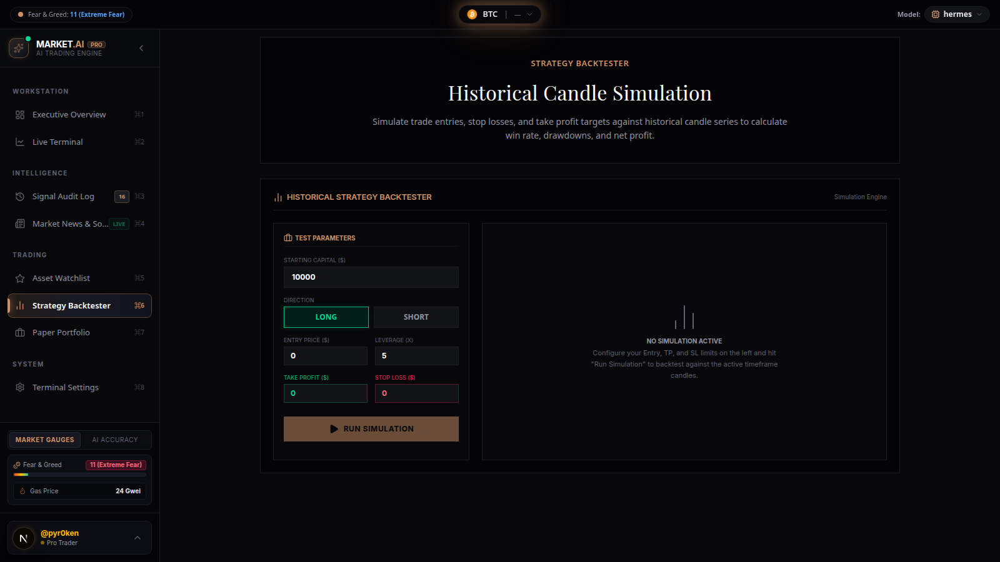
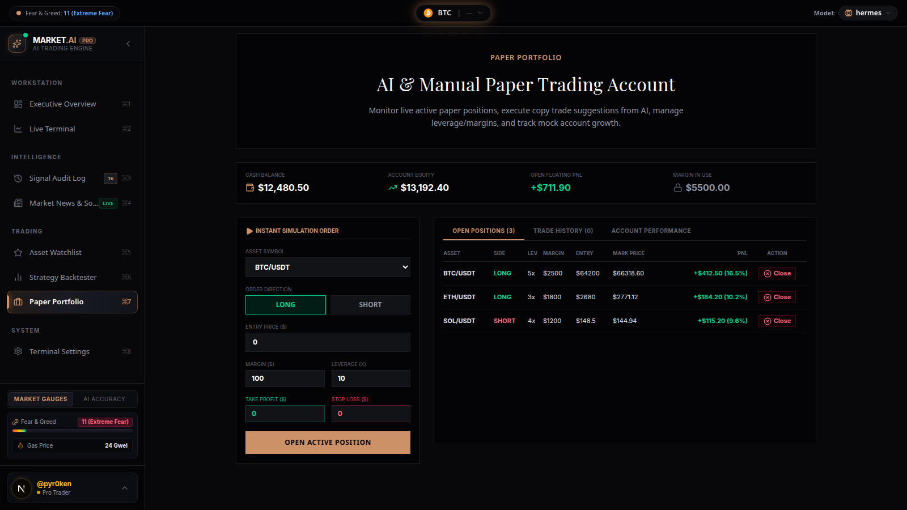
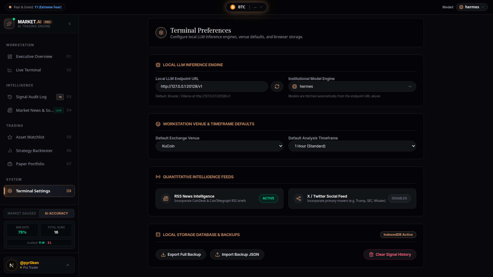

<h1 align="center">📈 Steep Quant — AI Trading &amp; Quantitative Intelligence Platform</h1>

<p align="center">
  A full-stack quantitative trading terminal and AI market intelligence platform built with <b>Next.js 16 (App Router)</b>, <b>React 19</b>, <b>Tailwind CSS v4</b>, <b>CCXT</b>, <b>SQLite</b>, and <b>Local AI Streaming</b>.
</p>

<p align="center">
  
  
  
  
  
  
</p>

---

## Table of Contents

- [Introduction](#introduction)
- [Platform Interface & Screenshots](#platform-interface--screenshots)
  - [1. Executive Performance Overview & Signal Audit](#1-executive-performance-overview--signal-audit)
  - [2. Live Quantitative Terminal & Split-Screen Intelligence](#2-live-quantitative-terminal--split-screen-intelligence)
  - [3. Market Intelligence & Alpha Discovery](#3-market-intelligence--alpha-discovery)
  - [4. Algorithmic Strategy Backtesting](#4-algorithmic-strategy-backtesting)
  - [5. Paper Trading Portfolio & Risk Analytics](#5-paper-trading-portfolio--risk-analytics)
  - [6. Workspace Authentication & Configuration](#6-workspace-authentication--configuration)
- [Architecture](#architecture)
- [Environment Configuration](#environment-configuration)
- [Getting Started](#getting-started)

---

## Introduction

Designed for crypto traders and quant researchers, **Steep Quant** unifies real-time multi-exchange order flow, automated quantitative indicator engines (`EMA`, `SMA`, `RSI`, `MACD`, `Bollinger Bands`, `ATR`, `VWAP`), deep orderbook and liquidation heatmaps, historical strategy backtesting, paper portfolio simulation, and Senior Trader AI market analysis with RTL Persian synthesis.

---

## Platform Interface & Screenshots

### 1. Executive Performance Overview & Signal Audit

Comprehensive dashboard tracking signal win rates, paper PnL, per-symbol accuracy, and historical signal replay.

| Executive Performance Dashboard | Historical Signal Audit Log | Deep Signal Analysis Replay |
| :---: | :---: | :---: |
|  |  |  |
| <sub>Signal win rates (79%), paper PnL (+662.30 USDT), and per-symbol accuracy matrix.</sub> | <sub>Granular audit trail with TP/SL targets, risk-reward ratios, and outcomes.</sub> | <sub>Replay modal showing exact market conditions, multi-TF indicators, and AI rationale.</sub> |

---

### 2. Live Quantitative Terminal & Split-Screen Intelligence

Real-time trading workspace combining interactive candlestick charts, order flow, depth charts, whale transactions, and an embedded AI copilot.

| Split-Screen Workspace (Top View) | Quantitative AI Analysis & Pine Script |
| :---: | :---: |
|  |  |
| <sub>Live BTC/USDT candlestick charting with synchronized orderbook depth, recent trades, and whale activity stream.</sub> | <sub>RTL Persian technical synthesis, executable Pine Script v5 strategy code, and interactive quant assistant chat.</sub> |

| Technical Indicators & Confluence Engine | Order Flow CVD & Market Macro Dynamics |
| :---: | :---: |
|  |  |
| <sub>Server-calculated moving averages, oscillators, volatility bands, and key support & resistance price levels.</sub> | <sub>Cumulative Volume Delta (CVD), liquidation clusters, funding rates, and macroeconomic sentiment scores.</sub> |

| Live Terminal Signal Replay Overlay | Interactive Quant Chat & Custom Queries |
| :---: | :---: |
|  |  |
| <sub>In-terminal historical signal replay with entry, stop-loss, target levels, and confluence breakdown.</sub> | <sub>Direct conversation with the quant LLM engine for ad-hoc scenario testing, risk assessment, and trade tuning.</sub> |

---

### 3. Market Intelligence & Alpha Discovery

Aggregated crypto newswires, sentiment analysis, real-time asset watchlist, and rapid keyboard navigation.

| Crypto Newswire & Social Sentiment | Multi-Asset Watchlist | Quick Symbol Command Palette |
| :---: | :---: | :---: |
|  |  |  |
| <sub>Real-time crypto news aggregator paired with social sentiment momentum and headlines.</sub> | <sub>Live price tracking, 24h change, volatility scoring, and quick-pivot actions across assets.</sub> | <sub>Command palette (<code>Ctrl+K</code>) for sub-second keyboard-driven symbol switching.</sub> |

---

### 4. Algorithmic Strategy Backtesting

Historical simulation engine for testing trend-following, mean-reversion, and breakout models before capital deployment.

| Strategy Engine & Equity Curve |
| :---: |
|  |
| <sub>Historical backtester rendering equity curves, Sharpe ratio, maximum drawdown, and complete simulated execution trade logs.</sub> |

---

### 5. Paper Trading Portfolio & Risk Analytics

Zero-risk simulated execution environment for live-forward testing strategies under real exchange spread and slippage conditions.

| Paper Portfolio Overview | Closed Positions & Performance Metrics |
| :---: | :---: |
|  |  |
| <sub>Simulated wallet balance, available margin, asset allocation distribution, and active open positions.</sub> | <sub>Historical record of closed simulated trades with realized PnL, holding duration, and win/loss statistics.</sub> |

---

### 6. Workspace Authentication & Configuration

Secure multi-user session management and modular engine settings.

| Workspace Authentication | Terminal Settings & API Configs | Risk Rules & Execution Defaults |
| :---: | :---: | :---: |
|  |  |  |
| <sub>Clean authentication interface supporting workspace sign-in and local offline session fallback.</sub> | <sub>Model selection, exchange connectivity settings, and custom LLM inference endpoint setup.</sub> | <sub>Default position sizing, leverage caps, automated stop-loss thresholds, and alerts.</sub> |

---

## Architecture

```
├── app/
│   ├── page.tsx                      # Main Workspace & Terminal Entry
│   ├── layout.tsx                    # Root Layout (Dark Theme & Persian Font Support)
│   └── api/
│       ├── market/                   # Exchange Connectors (CCXT OHLCV, Orderbook, Ticker)
│       ├── news/                     # Multi-Source Crypto RSS & Alpha Newswire
│       ├── db/                       # Local SQLite Database & Session Management
│       └── analysis/stream/          # Quant LLM SSE Stream Route Handler
├── components/
│   ├── layout/                       # Sidebar, Navigation & App Headers
│   ├── terminal/                     # Charting, Orderbook, CVD & Quant Console
│   ├── market/                       # Watchlist, Indicator Matrix & Macro Stats
│   ├── analysis/                     # RTL Markdown AI Card & Reasoning Skeletons
│   ├── backtest/                     # Strategy Runner & Performance Visualizations
│   └── paper/                        # Virtual Account Balances & Position Tables
├── lib/
│   ├── llm/                          # OpenAI-Compatible Streaming Client
│   ├── market/                       # CCXT Services, Indicator Mathematics & Aggregators
│   ├── db/                           # SQLite Storage Engine & Database Schema
│   └── prompts/                      # Quantitative Senior Analyst Prompt Templates
└── types/                            # Universal TypeScript Data Contracts
```

---

## Environment Configuration

Create or edit `.env.local`:

```env
# AI Engine Configuration (OpenAI-compatible endpoint)
LLM_BASE_URL=http://localhost:8000/v1
LLM_API_KEY=your_api_key_or_empty
LLM_MODEL=default-model

# Market Data Defaults
DEFAULT_EXCHANGE=bybit
DEFAULT_TIMEFRAME=1h

# Database Path
DATABASE_PATH=./data/trading.db
```

---

## Getting Started

### 1. Prerequisites
- **Node.js**: v18.17 or higher
- **npm** or **pnpm**

### 2. Install Dependencies
```bash
npm install
```

### 3. Run Development Server
```bash
npm run dev
```

Open [http://localhost:3000](http://localhost:3000) in your browser.

### 4. Build for Production
```bash
npm run build
npm run start
```
