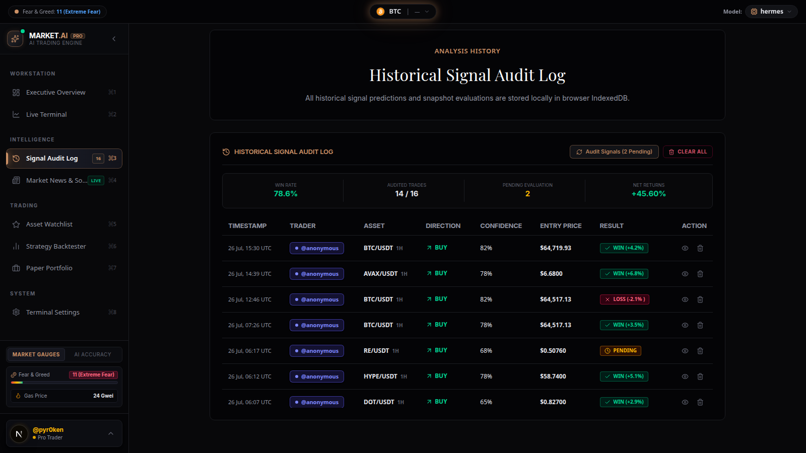
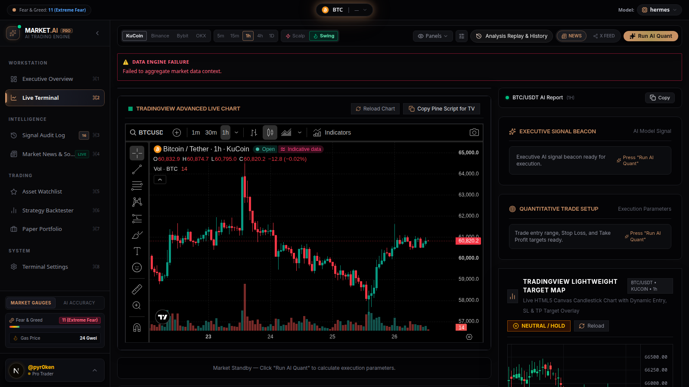
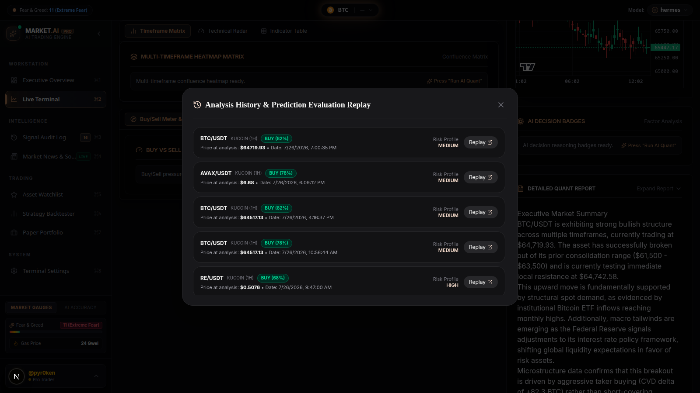
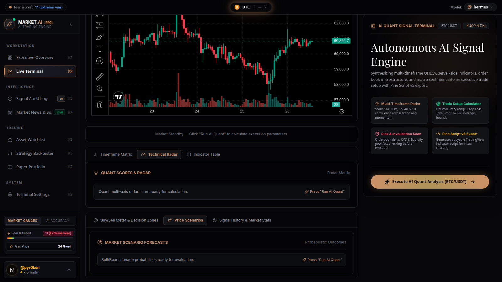
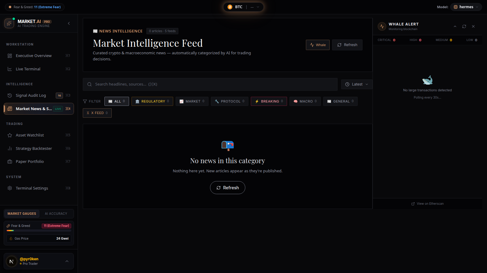
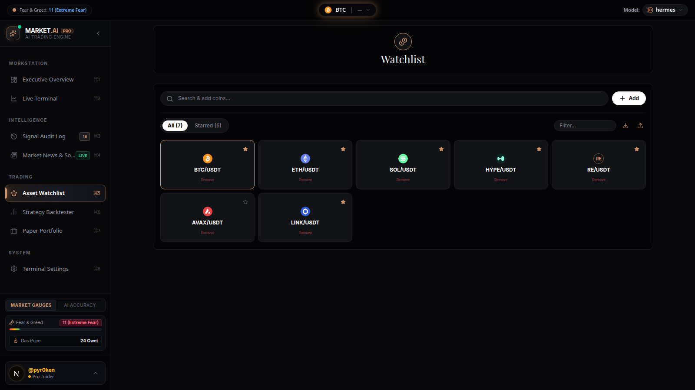
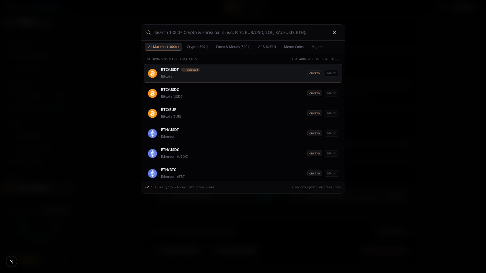
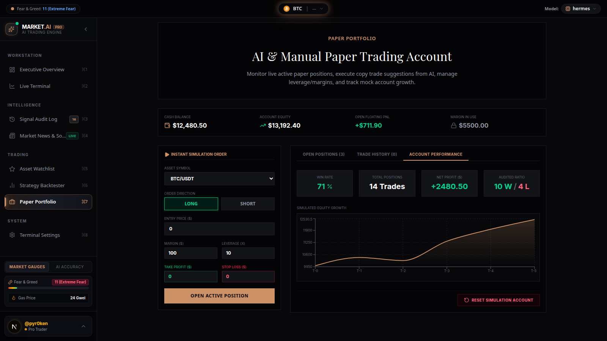
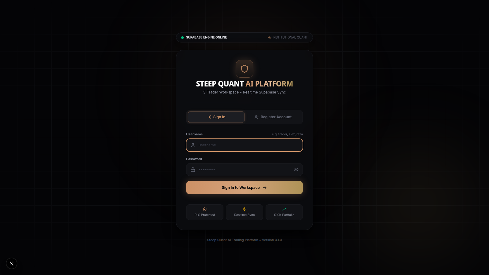
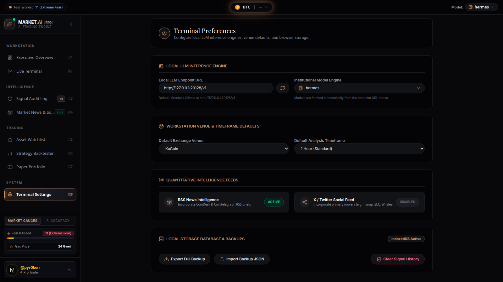

# 🚀 Steep Quant — AI Trading & Quantitative Intelligence Platform (v1)

A full-stack quantitative trading terminal and AI market intelligence platform built with **Next.js 14+ (App Router)**, **Tailwind CSS**, **Node CCXT**, **SQLite**, and **Local AI Streaming**.

Designed for crypto traders and quant researchers, the platform provides real-time multi-exchange order flow, automated quantitative indicator engines (EMA, SMA, RSI, MACD, Bollinger Bands, ATR, VWAP), deep orderbook and liquidation heatmaps, historical strategy backtesting, paper portfolio simulation, and Senior Trader AI market analysis with RTL Persian synthesis.

---

## 📸 Platform Interface & Screenshots

### 1. Executive Performance Overview & Signal Audit
Comprehensive dashboard tracking win rates, live PnL, AI signal executions across multiple crypto assets, and audit logs with historical replay.

#### Executive Performance Dashboard

*High-level performance summary showing signal win rates (79%), paper trading PnL (+662.30 USDT), and per-symbol accuracy matrix.*

#### Historical Signal Audit Log

*Granular audit trail of all generated signals with target take-profit (TP), stop-loss (SL), risk-reward ratios, and execution outcomes.*

#### Deep Signal Analysis Replay

*Detailed signal modal replaying exact market conditions, multi-timeframe indicator states, and AI decision rationale.*

---

### 2. Live Quantitative Terminal & Split-Screen Intelligence
Real-time trading workspace combining interactive candlestick charts, order flow, depth charts, whale transactions, and an embedded AI copilot.

#### Split-Screen Workspace (Top View)

*Live BTC/USDT candlestick charting with synchronized orderbook depth, recent trades, and whale activity stream.*

#### Quantitative AI Analysis & Pine Script Generation (Lower View)

*RTL Persian technical synthesis, executable Pine Script v5 strategy code, and interactive quant assistant chat.*

#### Technical Indicators & Confluence Engine

*Server-calculated moving averages, oscillators, volatility bands, and key support & resistance price levels.*

#### Order Flow CVD & Market Macro Dynamics

*Cumulative Volume Delta (CVD), liquidation clusters, funding rates, and macroeconomic sentiment scores.*

#### Interactive Quant Chat & Custom Queries

*Direct conversation with the quant LLM engine for ad-hoc scenario testing, risk assessment, and trade parameter tuning.*

---

### 3. Market Intelligence & Alpha Discovery
Aggregated crypto newswires, sentiment analysis, real-time asset watchlist, and rapid navigation.

#### Crypto Newswire & Social Sentiment Stream

*Curated real-time crypto news aggregator paired with social sentiment momentum and market-moving headlines.*

#### Multi-Asset Watchlist

*Real-time price tracking, 24h change, volatility scoring, and quick-pivot actions across major digital assets.*

#### Quick Symbol Command Palette

*Command palette (`Ctrl+K`) for sub-second keyboard-driven symbol navigation and terminal switching.*

---

### 4. Algorithmic Strategy Backtesting
Historical simulation engine for testing trend-following, mean-reversion, and breakout models before capital deployment.

#### Strategy Engine & Equity Curve

*Historical backtester rendering equity curves, Sharpe ratio, maximum drawdown, and complete simulated execution trade logs.*

---

### 5. Paper Trading Portfolio & Risk Analytics
Zero-risk simulated execution environment for live-forward testing strategies under real exchange spread and slip conditions.

#### Paper Portfolio Overview

*Simulated wallet balance, available margin, asset allocation distribution, and active open positions.*

#### Closed Positions & Performance Metrics

*Historical record of closed simulated trades with realized PnL, holding duration, and win/loss statistics.*

---

### 6. Workspace Authentication & Configuration
Secure multi-user session management and modular engine settings.

#### Workspace Authentication

*Clean authentication interface supporting workspace sign-in and local offline session fallback.*

#### Terminal Settings & API Configurations

*Model selection, exchange connectivity settings, and custom LLM inference endpoint configuration.*

#### Risk Management Rules & Execution Defaults

*Default position sizing, leverage caps, automated stop-loss thresholds, and alert notifications.*

---

## 🏗️ Architecture

```
├── app/
│   ├── page.tsx                      # Main Workspace & Terminal Entry
│   ├── layout.tsx                    # Root Layout (Dark Theme & Persian Font Support)
│   └── api/
│       ├── market/                   # Exchange Connectors (CCXT OHLCV, Orderbook, Ticker)
│       ├── news/                     # Multi-Source Crypto RSS & Alpha Newswire
│       ├── db/                       # Local SQLite Database & Session Management
│       └── analysis/stream/          # Quant LLM SSE Stream Route Handler
├── components/
│   ├── layout/                       # Sidebar, Navigation & App Headers
│   ├── terminal/                     # Charting, Orderbook, CVD & Quant Console
│   ├── market/                       # Watchlist, Indicator Matrix & Macro Stats
│   ├── analysis/                     # RTL Markdown AI Card & Reasoning Skeletons
│   ├── backtest/                     # Strategy Runner & Performance Visualizations
│   └── paper/                        # Virtual Account Balances & Position Tables
├── lib/
│   ├── llm/                          # OpenAI-Compatible Streaming Client
│   ├── market/                       # CCXT Services, Indicator Mathematics & Aggregators
│   ├── db/                           # SQLite Storage Engine & Database Schema
│   └── prompts/                      # Quantitative Senior Analyst Prompt Templates
└── types/                            # Universal TypeScript Data Contracts
```

---

## ⚙️ Environment Configuration

Create or edit `.env.local`:

```env
# AI Engine Configuration (OpenAI-compatible endpoint)
LLM_BASE_URL=http://localhost:8000/v1
LLM_API_KEY=your_api_key_or_empty
LLM_MODEL=default-model

# Market Data Defaults
DEFAULT_EXCHANGE=bybit
DEFAULT_TIMEFRAME=1h

# Database Path
DATABASE_PATH=./data/trading.db
```

---

## 💻 Getting Started

### 1. Prerequisites
- **Node.js**: v18.17 or higher
- **npm** or **pnpm**

### 2. Install Dependencies
```bash
npm install
```

### 3. Run Development Server
```bash
npm run dev
```

Open [http://localhost:3000](http://localhost:3000) in your browser.

### 4. Build for Production
```bash
npm run build
npm run start
```
