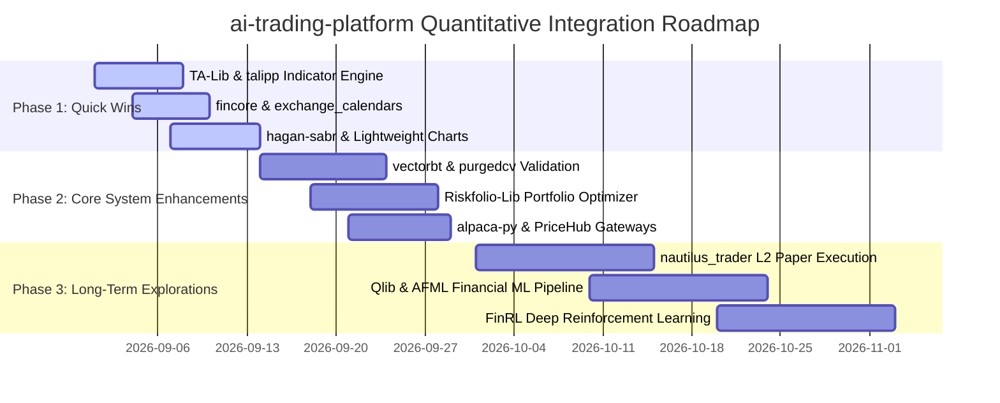

# Executive Audit Report: `awesome-quant` Evaluation & Architecture Roadmap for `ai-trading-platform`

**Author**: Senior Quantitative Finance Architect & Systems Engineer  
**Target Platform**: `ai-trading-platform` (FastAPI Python Backend + Next.js 16 / React 19 Frontend + Supabase PostgreSQL)  
**Source Repository Audited**: [wilsonfreitas/awesome-quant](https://github.com/wilsonfreitas/awesome-quant)  
**Date**: August 2026  

---

## 1. Executive Overview & High-Impact Quick Wins

### 1.1 Executive Summary
An exhaustive quantitative finance and software architecture audit of the `awesome-quant` repository was conducted to identify high-value libraries, tools, and frameworks for integration into the `ai-trading-platform`. The audit evaluated hundreds of projects spanning numerical computing, option pricing, technical indicators, event-driven backtesting, portfolio optimization, alternative sentiment analysis, and interactive data visualization.

Modern quantitative systems have migrated away from unoptimized Python loops and unmaintained monolithic packages toward **vectorized execution engines (Numba, C++, Rust)**, **incremental streaming indicators with $O(1)$ tick updating**, **leak-free cross-validation math (Purged CV / CPCV)**, and **convex risk optimization (CVaR / Risk Parity)**.

To maximize engineering return-on-investment and enhance system performance without introducing unnecessary architecture bloat, candidates were strictly filtered against our Feature-Folder Architecture:
- **Backend Stack**: Python 3.12+ / FastAPI microservices located in `backend/app/features/` (`quant/`, `market/`, `ai_streaming/`).
- **Frontend Stack**: Next.js 16 (App Router) + React 19 + Tailwind CSS v4 in `frontend/features/` (`market-charts/`, `paper-trading/`, `ai-advisor/`).
- **Database & Auth**: Supabase (PostgreSQL + RLS).

---

### 1.2 Top 5 High-Impact Quick-Win Recommendations

| # | Recommended Library | Category | Target Location in System | Key Impact & Problem Solved |
|---|---|---|---|---|
| **1** | **`TA-Lib` + `talipp`** | Tech Indicators | `backend/app/features/quant/` | **Dual-Speed Indicator Engine**: Replaces slow custom indicator math with C-backed vectorized `TA-Lib` for historical bars, and $O(1)$ stateful `talipp` for live WebSocket tick streaming. |
| **2** | **`vectorbt` + `purgedcv`** | Backtesting & Validation | `backend/app/features/quant/` | **Ultra-Fast Overfitting-Proof Strategy Testing**: Evaluates thousands of parameter combinations in seconds via Numba arrays, enforced with Purged Combinatorial Cross-Validation (CPCV) and Deflated Sharpe Ratios. |
| **3** | **`Riskfolio-Lib` + `fincore`** | Portfolio & Risk Analytics | `backend/app/features/quant/` | **Institutional Risk Modeling**: Adds convex Mean-Risk/CVaR optimization, Risk Parity, Black-Litterman allocation, and 150+ metrics (Sortino, Tail Ratio, Max Drawdown, VaR). |
| **4** | **`nautilus_trader`** | Simulation & Execution | `backend/app/features/paper-trading/` | **High-Fidelity Paper Trading Engine**: Event-driven Rust backtesting engine simulating L2/L3 order book queue placement, fill latency, and slippage for realistic paper execution. |
| **5** | **`hagan-sabr` + `Lightweight Charts`** | Options Math & Charting | `frontend/features/market-charts/` & `paper-trading/` | **Edge Volatility Modeling & Canvas Visuals**: Zero-dependency TypeScript SABR volatility surface & Greeks calculations directly on the client, rendered on TradingView Lightweight Charts. |

---

## 2. Category Audit Matrices

### Category A: Quantitative Technical Analysis & Feature Engineering
| Project / Library | Language | Primary Purpose | Relevance to `ai-trading-platform` | Priority |
|---|---|---|---|---|
| [TA-Lib](https://github.com/mrjbq7/ta-lib) | Python / C | C-accelerated technical indicators | High performance batch indicator calculation for OHLCV bars | **High** |
| [talipp](https://github.com/nardew/talipp) | Python | Incremental $O(1)$ streaming TA indicators | Real-time WebSocket tick updating without recomputing full series | **High** |
| [ta](https://github.com/bukosabino/ta) / [pandas-ta](https://github.com/twopirllc/pandas-ta) | Python | Pandas-native technical indicators | Pure Python fallback & feature extraction for pandas DataFrames | **Medium** |
| [lppls](https://github.com/Boulder-Investment-Technologies/lppls) | Python | Log-Periodic Power Law Singularity modeling | Financial bubble detection and crash probability forecasting | **Medium** |
| [QuantWave](https://github.com/lavs9/quantwave) | Python / Polars / Rust | Polars-native batch/streaming TA | Extreme throughput Polars-backed feature pipelines | Low |
| [Tulipy](https://github.com/cirla/tulipy) | Python / C | Tulip Indicators Python bindings | Alternative C indicator bindings | Low |

---

### Category B: Portfolio Optimization, Risk Management & Performance Analytics
| Project / Library | Language | Primary Purpose | Relevance to `ai-trading-platform` | Priority |
|---|---|---|---|---|
| [Riskfolio-Lib](https://github.com/dcajasn/Riskfolio-Lib) | Python | Convex portfolio optimization (CVaR, Risk Parity, HPO) | Institutional portfolio construction and risk allocation | **High** |
| [fincore](https://github.com/cloudQuant/fincore) | Python | Active successor to `empyrical`/`pyfolio` (150+ metrics) | Complete risk, drawdown, Sharpe, Sortino, and tearsheet generation | **High** |
| [PyPortfolioOpt](https://github.com/robertmartin8/PyPortfolioOpt) | Python | Classical & shrinkage portfolio optimization | Efficient Frontier, Mean-Variance, and Black-Litterman modeling | **High** |
| [skfolio](https://github.com/skfolio/skfolio) | Python | Scikit-Learn compatible portfolio optimization | Seamless integration into `scikit-learn` ML pipelines and grid search | **Medium** |
| [hagan-sabr](https://github.com/moshejs/hagan-sabr) | TypeScript | Zero-dependency SABR volatility expansion math | Client-side options implied volatility surface & Greeks in React/Edge | **Medium** |
| [fortitudo.tech](https://github.com/fortitudo-tech/fortitudo.tech) | Python | CVaR & Entropy Pooling stress testing | Scenario modeling and macro stress testing | Low |

---

### Category C: High-Performance Backtesting & Strategy Simulation Engines
| Project / Library | Language | Primary Purpose | Relevance to `ai-trading-platform` | Priority |
|---|---|---|---|---|
| [vectorbt](https://github.com/polakowo/vectorbt) | Python / Numba | Vectorized backtesting & hyperparameter tuning | Fast signal matrix exploration & parameter grid sweeps | **High** |
| [purgedcv](https://github.com/eslazarev/purged-cross-validation) | Python | Purged & Combinatorial Purged Cross-Validation | Preventing financial ML data leakage & measuring Deflated Sharpe | **High** |
| [nautilus_trader](https://github.com/nautechsystems/nautilus_trader) | Python / Rust | High-performance event-driven backtesting engine | Precise order book, fill-latency, and paper trading execution | **High** |
| [Backtesting.py](https://kernc.github.io/backtesting.py/) | Python | Lightweight event-driven backtesting framework | Interactive backtest visualization and rapid prototyping | **Medium** |
| [backtrader (cloudQuant)](https://github.com/cloudQuant/backtrader) | Python | Maintained event-driven backtesting engine | Robust multi-feed event-driven strategy testing | **Medium** |
| [barter-rs](https://github.com/barter-rs/barter-rs) | Rust | Rust live trading & backtesting framework | Ultra-low latency Rust sidecar trading | Low |

---

### Category D: Real-Time Market Data Gateways, Order Execution & Exchange Adapters
| Project / Library | Language | Primary Purpose | Relevance to `ai-trading-platform` | Priority |
|---|---|---|---|---|
| [CCXT](https://github.com/ccxt/ccxt) | Python / JS | Multi-exchange REST/WebSocket API gateway | Unified connection to 100+ crypto spot and futures exchanges | **High** |
| [exchange_calendars](https://github.com/gerrymanoim/exchange_calendars) | Python | Exchange trading session & holiday calendars | Session timing, market open/close checks, and alignment | **High** |
| [alpaca-py](https://github.com/alpacahq/alpaca-py) | Python | Alpaca Brokerage market data & order execution SDK | US Stock & Crypto paper/live order routing gateway | **High** |
| [pricehub](https://github.com/eslazarev/pricehub) | Python | Unified multi-exchange historical OHLCV fetcher | Multi-source crypto price aggregation into normalized DataFrames | **Medium** |
| [pmxt](https://github.com/pmxt-dev/pmxt) | Python / JS | Unified prediction market API (Polymarket/Kalshi) | Event market sentiment & prediction probability integration | Low |

---

### Category E: Financial ML, Sentiment Analysis & Quantitative NLP
| Project / Library | Language | Primary Purpose | Relevance to `ai-trading-platform` | Priority |
|---|---|---|---|---|
| [Qlib](https://github.com/microsoft/qlib) | Python | AI-oriented quantitative investment platform by Microsoft | End-to-end factor mining, ML model training, and portfolio execution | **High** |
| [mlfinlab](https://github.com/hudson-and-thames/mlfinlab) / [AFML](https://github.com/boyboi86/AFML) | Python | Financial Machine Learning algorithms (De Prado) | Triple barrier labeling, sample weights, and fractional differentiation | **High** |
| [FinRL-Library](https://github.com/AI4Finance-LLC/FinRL-Library) | Python | Deep Reinforcement Learning for trading (NeurIPS) | DRL agent training (PPO/SAC/DDPG) for dynamic position sizing | **Medium** |
| [functime](https://github.com/functime-org/functime) / [tsfresh](https://github.com/blue-yonder/tsfresh) | Python | Polars-scaled time-series ML feature extraction | Massive automated feature generation for ML signal rankers | **Medium** |
| [FinSignals](https://finsignals.ai) / [Asset News Sentiment](https://github.com/KVignesh122/AssetNewsSentimentAnalyzer) | Python | Financial news sentiment & direction classification | Enhancing VADER with financial LLM news scoring in `ai_streaming` | **Medium** |

---

### Category F: Financial Data Visualization & Interactive Charting
| Project / Library | Language | Primary Purpose | Relevance to `ai-trading-platform` | Priority |
|---|---|---|---|---|
| [TradingView Lightweight Charts](https://github.com/tradingview/lightweight-charts) | TypeScript / JS | High-performance HTML5 canvas candlestick charts | Client-side interactive charting in `frontend/features/market-charts/` | **High** |
| [finplot](https://github.com/highfestiva/finplot) | Python | Fast PyQt financial charting library | Server-side or desktop research chart generation | **Medium** |
| [D-Tale](https://github.com/man-group/dtale) | Python | Interactive visualizer for Pandas DataFrames | Internal admin & quant research data inspection GUI | **Medium** |
| [dxcharts-lite](https://github.com/devexperts/dxcharts-lite) | JS / HTML5 Canvas | Financial charting library | Alternative canvas chart renderer | Low |

---

## 3. Deep-Dive Evaluations for Top Candidates

### 3.1 Category A: Technical Analysis & Feature Engineering

#### 1. TA-Lib (`ta-lib`)
- **Repository**: [https://github.com/mrjbq7/ta-lib](https://github.com/mrjbq7/ta-lib)
- **Core Capabilities**: C-accelerated binding to ANSI C TA-Lib. Computes 150+ technical indicators (RSI, MACD, ADX, ATR, Bollinger Bands, Pattern Recognition) in vectorized C loops.
- **Target Integration Location**: `backend/app/features/quant/indicators.py`
- **Value Proposition**: Replaces standard Python for-loops and unoptimized pandas rolling functions. Increases indicator calculation throughput by up to $100\times$ for batch historical data processing.
- **Trade-offs & Complexity**: Requires underlying C library `libta-lib` compiled on host/container.
- **Implementation Strategy**:
  ```bash
  pip install TA-Lib
  ```
  ```python
  import talib
  import numpy as np

  def compute_core_indicators(close: np.ndarray, high: np.ndarray, low: np.ndarray):
      rsi = talib.RSI(close, timeperiod=14)
      macd, macdsignal, macdhist = talib.MACD(close, fastperiod=12, slowperiod=26, signalperiod=9)
      adx = talib.ADX(high, low, close, timeperiod=14)
      atr = talib.ATR(high, low, close, timeperiod=14)
      return {"rsi": rsi, "macd": macd, "adx": adx, "atr": atr}
  ```

#### 2. talipp
- **Repository**: [https://github.com/nardew/talipp](https://github.com/nardew/talipp)
- **Core Capabilities**: Incremental technical analysis library. Maintains stateful indicator objects that update in $O(1)$ time per incoming price tick.
- **Target Integration Location**: `backend/app/features/quant/streaming_indicators.py`
- **Value Proposition**: Standard TA libraries require re-calculating whole DataFrames on every new WebSocket tick. `talipp` processes live streaming ticks instantly with zero redundant array memory allocation.
- **Trade-offs & Complexity**: Higher memory overhead per active symbol state object.
- **Implementation Strategy**:
  ```bash
  pip install talipp
  ```
  ```python
  from talipp.indicators import RSI, MACD

  class RealTimeIndicatorStream:
      def __init__(self):
          self.rsi = RSI(period=14)
          self.macd = MACD(fast_period=12, slow_period=26, signal_period=9)

      def on_tick(self, price: float):
          self.rsi.add(price)
          self.macd.add(price)
          return {"current_rsi": self.rsi[-1], "current_macd": self.macd[-1].macd}
  ```

#### 3. ta (Technical Analysis Library in Pandas)
- **Repository**: [https://github.com/bukosabino/ta](https://github.com/bukosabino/ta)
- **Core Capabilities**: Pure Python pandas feature engineering library with 40+ indicators categorized by momentum, volume, volatility, and trend.
- **Target Integration Location**: `backend/app/features/quant/feature_pipeline.py`
- **Value Proposition**: Fallback when C dependencies for `TA-Lib` cannot be compiled (e.g. lightweight serverless functions). Seamlessly injects indicator columns directly into Pandas DataFrames for machine learning input matrices.
- **Trade-offs & Complexity**: Slower execution speed compared to C-backed TA-Lib.
- **Implementation Strategy**:
  ```bash
  pip install ta
  ```
  ```python
  import pandas as pd
  from ta import add_all_ta_features

  def generate_ml_features(df: pd.DataFrame) -> pd.DataFrame:
      return add_all_ta_features(df, open="open", high="high", low="low", close="close", volume="volume", fillna=True)
  ```

#### 4. lppls (Log-Periodic Power Law Singularity)
- **Repository**: [https://github.com/Boulder-Investment-Technologies/lppls](https://github.com/Boulder-Investment-Technologies/lppls)
- **Core Capabilities**: Fits the LPPLS model to time-series data to detect speculative bubbles and estimate crash dates (Didier Sornette's methodology).
- **Target Integration Location**: `backend/app/features/quant/bubble_detector.py`
- **Value Proposition**: Provides macro regime-risk detection. Alerts the platform's AI advisor when an asset enters a super-exponential bubble regime, triggering defensive risk management actions (tightening ATR stops or reducing position sizes).
- **Trade-offs & Complexity**: Non-linear optimization fitting can be computationally intensive; best executed on periodic background workers.
- **Implementation Strategy**:
  ```bash
  pip install lppls
  ```
  ```python
  import numpy as np
  from lppls import lppls

  def compute_bubble_confidence(time_array: np.ndarray, price_array: np.ndarray):
      lppls_model = lppls.LPPLS(observations=np.array([time_array, np.log(price_array)]))
      tc, m, w, a, b, c1, c2 = lppls_model.fit(max_searches=25)
      return {"estimated_crash_time": tc, "bubble_indicator": b < 0 and m > 0 and m < 1}
  ```

---

### 3.2 Category B: Portfolio Optimization & Risk Analytics

#### 5. Riskfolio-Lib
- **Repository**: [https://github.com/dcajasn/Riskfolio-Lib](https://github.com/dcajasn/Riskfolio-Lib)
- **Core Capabilities**: Quantitative portfolio optimization built on `scipy` and `cvxpy`. Implements Mean-Variance, Mean-CVaR, Mean-CDaR, Risk Parity, Hierarchical Risk Parity (HRP), and Nested Clustered Optimization (NCO).
- **Target Integration Location**: `backend/app/features/quant/portfolio_optimizer.py`
- **Value Proposition**: Transforms simple paper-trading allocation into institutional portfolio management. Computes exact convex risk-optimal weights using Conditional Value at Risk (CVaR) to protect portfolios from fat-tail crypto market crashes.
- **Trade-offs & Complexity**: Requires solver backends (`CVXPY`, `CLARABEL`, `GLPK`).
- **Implementation Strategy**:
  ```bash
  pip install riskfolio-lib
  ```
  ```python
  import riskfolio as rp
  import pandas as pd

  def optimize_cvar_portfolio(returns_df: pd.DataFrame) -> pd.DataFrame:
      port = rp.Portfolio(returns=returns_df)
      port.assets_stats(method_mu='hist', method_cov='ledoit')
      weights = port.optimization(model='Classic', rm='CVaR', obj='MinRisk', rf=0.04)
      return weights
  ```

#### 6. fincore (Successor to `empyrical` / `pyfolio`)
- **Repository**: [https://github.com/cloudQuant/fincore](https://github.com/cloudQuant/fincore)
- **Core Capabilities**: High-performance quantitative performance and risk analytics library featuring over 150 metrics (Sharpe, Sortino, Calmar, Omega, Tail Ratio, Value at Risk, Maximum Drawdown Duration, Alpha, Beta).
- **Target Integration Location**: `backend/app/features/quant/risk_engine.py`
- **Value Proposition**: Provides standard, verified financial metrics for strategy evaluation. Replaces ad-hoc custom drawdown math with audited formulas used by institutional hedge funds.
- **Trade-offs & Complexity**: Minimal; direct dependency on `numpy` and `pandas`.
- **Implementation Strategy**:
  ```bash
  pip install fincore
  ```
  ```python
  import fincore as fc
  import pandas as pd

  def EvaluateStrategyPerformance(returns: pd.Series, benchmark_returns: pd.Series):
      return {
          "sharpe_ratio": fc.sharpe_ratio(returns, risk_free=0.04),
          "sortino_ratio": fc.sortino_ratio(returns, required_return=0.0),
          "max_drawdown": fc.max_drawdown(returns),
          "cvar_95": fc.value_at_risk(returns, cutoff=0.05),
          "alpha": fc.alpha(returns, benchmark_returns),
          "beta": fc.beta(returns, benchmark_returns)
      }
  ```

#### 7. PyPortfolioOpt
- **Repository**: [https://github.com/robertmartin8/PyPortfolioOpt](https://github.com/robertmartin8/PyPortfolioOpt)
- **Core Capabilities**: Classical Efficient Frontier, Black-Litterman allocation (incorporating subjective analyst views), covariance shrinkage (Ledoit-Wolf), and Hierarchical Risk Parity.
- **Target Integration Location**: `backend/app/features/quant/black_litterman.py`
- **Value Proposition**: Allows the platform's **AI Advisor** (`ai_streaming`) to feed LLM market sentiment (e.g. "+5% bullish view on ETH") directly into a Black-Litterman optimization matrix to calculate revised asset weights.
- **Trade-offs & Complexity**: Requires setting up prior certainty parameters.
- **Implementation Strategy**:
  ```bash
  pip install PyPortfolioOpt
  ```
  ```python
  from pypfopt import BlackLittermanModel, risk_models, expected_returns
  import pandas as pd

  def blend_ai_views_with_market(prices: pd.DataFrame, ai_views: dict, ai_confidences: list):
      cov = risk_models.CovarianceShrinkage(prices).ledoit_wolf()
      delta = 2.5
      prior_returns = expected_returns.capm_return(prices)
      bl = BlackLittermanModel(cov, Q=ai_views, P=..., omega="idx", view_confidences=ai_confidences, tau=0.05, risk_aversion=delta)
      return bl.bl_returns(), bl.bl_cov()
  ```

#### 8. skfolio
- **Repository**: [https://github.com/skfolio/skfolio](https://github.com/skfolio/skfolio)
- **Core Capabilities**: Scikit-Learn compatible portfolio optimization library. Provides estimators, transformers, and model selection tools that work with `GridSearchCV` and `Pipeline`.
- **Target Integration Location**: `backend/app/features/quant/ml_portfolio.py`
- **Value Proposition**: Enables hyperparameter tuning of portfolio allocation models using standard scikit-learn validation techniques.
- **Trade-offs & Complexity**: Requires understanding scikit-learn API conventions.
- **Implementation Strategy**:
  ```bash
  pip install skfolio
  ```
  ```python
  from skfolio.optimization import MeanRisk, ObjectiveFunction
  from sklearn.model_selection import GridSearchCV

  def fit_sklearn_portfolio(returns_matrix):
      model = MeanRisk(objective_function=ObjectiveFunction.MINIMIZE_RISK)
      param_grid = {"risk_measure": ["variance", "cvar", "cdar"]}
      grid = GridSearchCV(model, param_grid, cv=5)
      grid.fit(returns_matrix)
      return grid.best_estimator_
  ```

#### 9. hagan-sabr (TypeScript)
- **Repository**: [https://github.com/moshejs/hagan-sabr](https://github.com/moshejs/hagan-sabr)
- **Core Capabilities**: Zero-dependency TypeScript implementation of the SABR stochastic volatility model (Hagan 2002 expansions, smile calibration). Matches QuantLib `sabrVolatility` to $10^{-9}$.
- **Target Integration Location**: `frontend/features/paper-trading/lib/sabrOptions.ts`
- **Value Proposition**: Runs options volatility smile calibration and Greeks calculation directly in the browser or Edge API route without making round-trip server calls to Python backend.
- **Trade-offs & Complexity**: Client-side execution relies on JavaScript floating-point precision.
- **Implementation Strategy**:
  ```bash
  npm install hagan-sabr
  ```
  ```typescript
  import { sabrVolatility } from 'hagan-sabr';

  export function getOptionsImpliedVol(forward: number, strike: number, expiry: number, alpha: number, beta: number, nu: number, rho: number): number {
    return sabrVolatility(forward, strike, expiry, alpha, beta, nu, rho);
  }
  ```

---

### 3.3 Category C: Backtesting & Strategy Simulation Engines

#### 10. vectorbt
- **Repository**: [https://github.com/polakowo/vectorbt](https://github.com/polakowo/vectorbt)
- **Core Capabilities**: Ultra-fast vectorized backtesting framework built on top of NumPy, Pandas, and Numba. Evaluates 100,000 strategy parameter combinations in seconds.
- **Target Integration Location**: `backend/app/features/quant/vectorized_backtester.py`
- **Value Proposition**: Eliminates slow event-driven loops during initial strategy discovery. Enables instant hyperparameter heatmaps (e.g. testing RSI periods 5 through 50 across 20 assets concurrently).
- **Trade-offs & Complexity**: High RAM consumption when allocating massive 3D Numba arrays.
- **Implementation Strategy**:
  ```bash
  pip install vectorbt
  ```
  ```python
  import vectorbt as vbt
  import numpy as np

  def fast_rsi_grid_search(close_prices: vbt.YFData):
      windows = np.arange(10, 30, 1)
      rsi = vbt.RSI.run(close_prices, window=windows)
      entries = rsi.rsi_crossed_below(30)
      exits = rsi.rsi_crossed_above(70)
      portfolio = vbt.Portfolio.from_signals(close_prices, entries, exits, init_cash=10000)
      return portfolio.total_return().groupby("rsi_window").max()
  ```

#### 11. purgedcv (Purged Cross-Validation & Deflated Sharpe Ratio)
- **Repository**: [https://github.com/eslazarev/purged-cross-validation](https://github.com/eslazarev/purged-cross-validation)
- **Core Capabilities**: `scikit-learn` compatible Purged, Group-Purged, and Combinatorial Purged (CPCV) cross-validation, plus backtest overfitting diagnostics (Deflated Sharpe Ratio, Probabilistic Sharpe Ratio, PBO).
- **Target Integration Location**: `backend/app/features/quant/validation_audit.py`
- **Value Proposition**: Prevents financial time-series data leakage (look-ahead bias) during machine learning model training and validates if backtest returns are genuine alpha or random overfitted noise.
- **Trade-offs & Complexity**: Combinatorial splitting increases compute time exponentially with fold count.
- **Implementation Strategy**:
  ```bash
  pip install purgedcv
  ```
  ```python
  from purgedcv import PurgedGroupTimeSeriesSplit
  from purgedcv.metrics import deflated_sharpe_ratio

  def validate_strategy_overfitting(returns_series, num_trials: int):
      dsr = deflated_sharpe_ratio(returns=returns_series, num_trials=num_trials)
      return {"deflated_sharpe_p_value": dsr}
  ```

#### 12. nautilus_trader
- **Repository**: [https://github.com/nautechsystems/nautilus_trader](https://github.com/nautechsystems/nautilus_trader)
- **Core Capabilities**: Event-driven backtesting and live trading engine written in Rust with Python bindings. Features microsecond-resolution simulation, L2/L3 order book reconstruction, queue priority modeling, and execution latency simulation.
- **Target Integration Location**: `backend/app/features/paper-trading/nautilus_engine.py`
- **Value Proposition**: Serves as the ultimate verification layer before going live. Unlike simple vectorized backtesters, Nautilus accurately models slippage, order queue mechanics, and limit order fill delays.
- **Trade-offs & Complexity**: Steeper learning curve; requires tick/order-book level data inputs.
- **Implementation Strategy**:
  ```bash
  pip install nautilus_trader
  ```
  ```python
  from nautilus_trader.config import BacktestEngineConfig
  from nautilus_trader.backtest.engine import BacktestEngine

  def run_l2_paper_simulation(data_config, strategy_config):
      engine = BacktestEngine(config=BacktestEngineConfig(trader_id="PAPER-001"))
      # Add venue, data, and strategy bindings...
      engine.run()
      return engine.trader.generate_account_report()
  ```

#### 13. Backtesting.py
- **Repository**: [https://kernc.github.io/backtesting.py/](https://kernc.github.io/backtesting.py/)
- **Core Capabilities**: Lightweight event-driven backtester in Python with built-in Bokeh interactive chart visualization and optimization hooks.
- **Target Integration Location**: `backend/app/features/quant/quick_backtest.py`
- **Value Proposition**: Ideal for rapid prototyping and rendering standalone interactive HTML backtest reports that can be embedded into Next.js dashboard iFrames.
- **Trade-offs & Complexity**: Single-asset focus per backtest run.
- **Implementation Strategy**:
  ```bash
  pip install Backtesting
  ```
  ```python
  from backtesting import Backtest, Strategy
  from backtesting.lib import crossover
  from backtesting.test import SMA

  class SmaCross(Strategy):
      n1 = 10
      n2 = 20
      def init(self):
          self.sma1 = self.I(SMA, self.data.Close, self.n1)
          self.sma2 = self.I(SMA, self.data.Close, self.n2)
      def next(self):
          if crossover(self.sma1, self.sma2):
              self.buy()
          elif crossover(self.sma2, self.sma1):
              self.position.close()

  def run_quick_test(df):
      bt = Backtest(df, SmaCross, cash=10000, commission=.002)
      stats = bt.run()
      return stats
  ```

#### 14. backtrader (cloudQuant Fork)
- **Repository**: [https://github.com/cloudQuant/backtrader](https://github.com/cloudQuant/backtrader)
- **Core Capabilities**: Actively maintained fork of `backtrader`. Supports multi-data, multi-strategy, multi-broker backtesting and live trading with modern Python 3.12 compatibility and MCP agent tooling.
- **Target Integration Location**: `backend/app/features/quant/backtrader_runner.py`
- **Value Proposition**: Provides a traditional event-driven architecture for complex multi-asset strategies requiring custom order types (stop-loss, take-profit trailing orders).
- **Trade-offs & Complexity**: Event loops are slower than vectorized backtesting engines.
- **Implementation Strategy**:
  ```bash
  pip install git+https://github.com/cloudQuant/backtrader.git
  ```
  ```python
  import backtrader as bt

  def execute_event_backtest(dataframe):
      cerebro = bt.Cerebro()
      data = bt.feeds.PandasData(dataname=dataframe)
      cerebro.adddata(data)
      cerebro.broker.setcash(100000.0)
      results = cerebro.run()
      return cerebro.broker.getvalue()
  ```

---

### 3.4 Category D: Market Data Gateways & Execution Adapters

#### 15. CCXT (Crypto Currency eXchange Trading)
- **Repository**: [https://github.com/ccxt/ccxt](https://github.com/ccxt/ccxt)
- **Core Capabilities**: Unified JavaScript and Python library connecting to 100+ cryptocurrency exchanges for REST market data, WebSockets, and order execution.
- **Target Integration Location**: `backend/app/features/market/exchange_client.py`
- **Value Proposition**: Normalizes market data structures (OHLCV, order books, trades, tickers) and execution endpoints across Binance, Bybit, OKX, Coinbase, Kraken, etc.
- **Trade-offs & Complexity**: Maintenance overhead handling frequent exchange API updates.
- **Implementation Strategy**:
  ```bash
  pip install ccxt
  ```
  ```python
  import ccxt.async_support as ccxt
  import pandas as pd

  async def fetch_unified_ohlcv(symbol: str, timeframe: str = '1h', limit: int = 100) -> pd.DataFrame:
      exchange = ccxt.binance({'enableRateLimit': True})
      bars = await exchange.fetch_ohlcv(symbol, timeframe, limit=limit)
      await exchange.close()
      df = pd.DataFrame(bars, columns=['timestamp', 'open', 'high', 'low', 'close', 'volume'])
      df['timestamp'] = pd.to_datetime(df['timestamp'], unit='ms')
      return df
  ```

#### 16. exchange_calendars
- **Repository**: [https://github.com/gerrymanoim/exchange_calendars](https://github.com/gerrymanoim/exchange_calendars)
- **Core Capabilities**: Precise trading calendars for 50+ global stock exchanges, bond markets, and 24/7 crypto. Tracks holidays, early closes, and settlement dates.
- **Target Integration Location**: `backend/app/features/market/calendar_service.py`
- **Value Proposition**: Prevents backtest contamination and live execution errors caused by submitting orders during closed market hours or unexpected holiday trading schedules.
- **Trade-offs & Complexity**: Periodic updates required as central exchanges publish new holiday schedules.
- **Implementation Strategy**:
  ```bash
  pip install exchange_calendars
  ```
  ```python
  import exchange_calendars as xcals
  import pandas as pd

  def is_nyse_open_now() -> bool:
      nyse = xcals.get_calendar("XNYS")
      now = pd.Timestamp.now(tz="UTC")
      return nyse.is_open_on_minute(now)
  ```

#### 17. alpaca-py
- **Repository**: [https://github.com/alpacahq/alpaca-py](https://github.com/alpacahq/alpaca-py)
- **Core Capabilities**: Official Python SDK for Alpaca's modern REST & WebSocket APIs covering US equities, options, and crypto paper/live trading.
- **Target Integration Location**: `backend/app/features/market/alpaca_broker.py`
- **Value Proposition**: Provides paper-trading order execution routing with real-time stock quotes without requiring expensive institutional data subscriptions.
- **Trade-offs & Complexity**: Restricted to assets supported on Alpaca.
- **Implementation Strategy**:
  ```bash
  pip install alpaca-py
  ```
  ```python
  from alpaca.trading.client import TradingClient
  from alpaca.trading.requests import MarketOrderRequest
  from alpaca.trading.enums import OrderSide, TimeInForce

  def place_paper_market_order(symbol: str, qty: float, side: str, api_key: str, secret_key: str):
      client = TradingClient(api_key, secret_key, paper=True)
      req = MarketOrderRequest(symbol=symbol, qty=qty, side=OrderSide.BUY if side=='buy' else OrderSide.SELL, time_in_force=TimeInForce.GTC)
      return client.submit_order(order_data=req)
  ```

#### 18. pricehub
- **Repository**: [https://github.com/eslazarev/pricehub](https://github.com/eslazarev/pricehub)
- **Core Capabilities**: Unified multi-exchange historical price collector for Binance, Bybit, Coinbase, OKX, Kraken, KuCoin, and Bitget.
- **Target Integration Location**: `backend/app/features/market/price_aggregator.py`
- **Value Proposition**: Automates fallback historical data fetching across multiple crypto venues if a primary exchange gateway goes offline or rate-limits requests.
- **Trade-offs & Complexity**: Dependent on third-party public API availability.
- **Implementation Strategy**:
  ```bash
  pip install pricehub
  ```
  ```python
  from pricehub import fetch_prices

  def get_aggregated_ohlcv(symbol="BTC/USDT", timeframe="1h", start="2026-01-01"):
      df = fetch_prices(exchanges=["binance", "bybit", "okx"], symbol=symbol, interval=timeframe, start=start)
      return df
  ```

---

### 3.5 Category E: Financial Machine Learning, Sentiment & Quantitative NLP

#### 19. Qlib (Microsoft AI Quantitative Investment Platform)
- **Repository**: [https://github.com/microsoft/qlib](https://github.com/microsoft/qlib)
- **Core Capabilities**: Complete AI-oriented quantitative platform. Features high-performance data preparation, automated alpha feature mining, LightGBM/CatBoost/PyTorch model training, and portfolio allocation engines.
- **Target Integration Location**: `backend/app/features/quant/qlib_pipeline.py`
- **Value Proposition**: Elevates platform capabilities from heuristic technical indicators to state-of-the-art machine learning alpha prediction.
- **Trade-offs & Complexity**: High complexity; requires initializing Qlib's binary data format.
- **Implementation Strategy**:
  ```bash
  pip install pyqlib
  ```
  ```python
  import qlib
  from qlib.data import D

  def init_qlib_engine():
      qlib.init(provider_uri="~/.qlib/qlib_data/us_data", region="us")
      features = D.features(["AAPL"], ["$close", "$volume", "Ref($close, 1)/$close - 1"], start_time="2025-01-01")
      return features
  ```

#### 20. mlfinlab / AFML (Marcos Lopez de Prado's Financial ML)
- **Repository**: [https://github.com/hudson-and-thames/mlfinlab](https://github.com/hudson-and-thames/mlfinlab) / [AFML Open Source](https://github.com/boyboi86/AFML)
- **Core Capabilities**: Implementation of "Advances in Financial Machine Learning". Includes Financial Data Structures (Dollar/Volume bars), Triple Barrier Labeling, Meta-Labeling, Sample Weights by Uniqueness, and Fractional Differentiation.
- **Target Integration Location**: `backend/app/features/quant/financial_ml.py`
- **Value Proposition**: standard time-series ML uses fixed horizon labels (+1d return) which causes false positive noise. Triple Barrier labeling applies dynamic profit-taking and stop-loss barriers based on volatility.
- **Trade-offs & Complexity**: Mathematically intensive data preprocessing.
- **Implementation Strategy**:
  ```bash
  pip install AFML
  ```
  ```python
  import pandas as pd
  # Triple Barrier Method concept:
  def apply_triple_barrier(prices: pd.Series, events: pd.DataFrame, pt_sl: list, volatility: pd.Series):
      # Computes upper (profit take), lower (stop loss), and vertical (expiration) barriers
      pass
  ```

#### 21. FinRL-Library (AI4Finance LLC)
- **Repository**: [https://github.com/AI4Finance-LLC/FinRL-Library](https://github.com/AI4Finance-LLC/FinRL-Library)
- **Core Capabilities**: Deep Reinforcement Learning (DRL) framework for quantitative trading (PPO, A2C, DDPG, SAC, TD3) using PyTorch and OpenAI Gym / ElegantRL environments.
- **Target Integration Location**: `backend/app/features/quant/drl_agent.py`
- **Value Proposition**: Trains adaptive autonomous trading agents that dynamically learn optimal execution actions in response to changing market regimes.
- **Trade-offs & Complexity**: High GPU compute overhead; long training time before convergence.
- **Implementation Strategy**:
  ```bash
  pip install finrl
  ```
  ```python
  from finrl.agents.stablebaselines3.models import DRLAgent
  from finrl.meta.env_stock_trading.env_stocktrading import StockTradingEnv

  def train_ppo_trader(df_train):
      env_kwargs = {"stock_dim": 1, "hmax": 100, "initial_amount": 100000, "buy_cost_pct": 0.001, "sell_cost_pct": 0.001, "reward_scaling": 1e-4}
      e_train_gym = StockTradingEnv(df=df_train, **env_kwargs)
      agent = DRLAgent(env=e_train_gym)
      model = agent.get_model("ppo")
      trained_model = agent.train_model(model=model, tb_log_name="ppo", total_timesteps=50000)
      return trained_model
  ```

#### 22. functime (Polars Time-Series ML)
- **Repository**: [https://github.com/functime-org/functime](https://github.com/functime-org/functime)
- **Core Capabilities**: Time-series machine learning at scale built on top of **Polars**. Computes hundreds of time series features with parallelized execution across multiple CPU cores.
- **Target Integration Location**: `backend/app/features/quant/polars_features.py`
- **Value Proposition**: Accelerates feature engineering by up to $20\times$ over Pandas when processing multi-year tick/minute datasets.
- **Trade-offs & Complexity**: Requires data conversion to Polars DataFrames.
- **Implementation Strategy**:
  ```bash
  pip install functime polars
  ```
  ```python
  import polars as pl
  from functime.feature_extraction import feature_extractors

  def extract_polars_features(df_polars: pl.DataFrame):
      features = df_polars.select(feature_extractors())
      return features
  ```

#### 23. FinSignals & Financial NLP Analyzers
- **Repository**: [https://github.com/KVignesh122/AssetNewsSentimentAnalyzer](https://github.com/KVignesh122/AssetNewsSentimentAnalyzer)
- **Core Capabilities**: Specialized financial news NLP models that classify sentiment, directional impact, and sarcasm in financial headlines.
- **Target Integration Location**: `backend/app/features/ai_streaming/sentiment_analyzer.py`
- **Value Proposition**: Upgrades generic VADER sentiment scoring (which often misinterprets financial jargon like "short squeeze" or "hawkish Fed") with domain-specific financial NLP scoring.
- **Trade-offs & Complexity**: Requires LLM API tokens or local HuggingFace transformer model memory allocation.
- **Implementation Strategy**:
  ```python
  # Integrated into backend/app/features/ai_streaming/
  from transformers import pipeline

  class FinancialSentimentEngine:
      def __init__(self):
          self.pipe = pipeline("text-classification", model="ProsusAI/finbert")

      def analyze_headline(self, text: str):
          res = self.pipe(text)[0]
          return {"label": res["label"].lower(), "score": float(res["score"])}
  ```

---

### 3.6 Category F: Financial Data Visualization & Interactive Charting

#### 24. TradingView Lightweight Charts
- **Repository**: [https://github.com/tradingview/lightweight-charts](https://github.com/tradingview/lightweight-charts)
- **Core Capabilities**: High-performance, zero-dependency HTML5 Canvas charting library by TradingView. Renders thousands of candlestick bars, volume histograms, and overlay lines at 60 FPS.
- **Target Integration Location**: `frontend/features/market-charts/components/CandlestickChart.tsx`
- **Value Proposition**: The gold standard for financial UI dashboards. Renders interactive candlestick charts with custom indicators without DOM bloat or WebGL compatibility issues.
- **Trade-offs & Complexity**: Requires managing canvas resize observers and React hooks properly.
- **Implementation Strategy**:
  ```bash
  npm install lightweight-charts
  ```
  ```typescript
  import { createChart, ColorType } from 'lightweight-charts';
  import { useEffect, useRef } from 'react';

  export const LightweightCandlestickChart = ({ data }: { data: any[] }) => {
    const chartContainerRef = useRef<HTMLDivElement>(null);

    useEffect(() => {
      if (!chartContainerRef.current) return;
      const chart = createChart(chartContainerRef.current, {
        layout: { background: { type: ColorType.Solid, color: '#090D16' }, textColor: '#D9D9D9' },
        width: chartContainerRef.current.clientWidth,
        height: 400,
      });
      const candleSeries = chart.addCandlestickSeries();
      candleSeries.setData(data);
      return () => chart.remove();
    }, [data]);

    return <div ref={chartContainerRef} className="w-full h-[400px]" />;
  };
  ```

#### 25. finplot
- **Repository**: [https://github.com/highfestiva/finplot](https://github.com/highfestiva/finplot)
- **Core Capabilities**: Performant Python financial plotting library built on PyQt/PyQtGraph. Renders millions of data points smoothly with low memory usage.
- **Target Integration Location**: `backend/app/features/quant/offline_charts.py`
- **Value Proposition**: Generates ultra-fast chart images or standalone research windows during Python strategy debugging without Matplotlib slowness.
- **Trade-offs & Complexity**: Requires GUI backend for desktop display.
- **Implementation Strategy**:
  ```bash
  pip install finplot
  ```
  ```python
  import finplot as fplot
  import pandas as pd

  def plot_quick_ohlcv(df: pd.DataFrame):
      fplot.candlestick_ochl(df[['open', 'close', 'high', 'low']])
      fplot.show()
  ```

#### 26. D-Tale
- **Repository**: [https://github.com/man-group/dtale](https://github.com/man-group/dtale)
- **Core Capabilities**: Visualizer for Pandas DataFrames and Xarray datasets. Combines a React frontend with a Python Flask/FastAPI backend for interactive data inspection, correlation matrices, histogram distributions, and outlier detection.
- **Target Integration Location**: `backend/app/features/quant/data_inspector.py`
- **Value Proposition**: Provides internal quantitative researchers and administrators with a powerful GUI to inspect historical market data tables and strategy performance outputs.
- **Trade-offs & Complexity**: Launches a secondary web server instance.
- **Implementation Strategy**:
  ```bash
  pip install dtale
  ```
  ```python
  import dtale
  import pandas as pd

  def launch_dataframe_inspector(df: pd.DataFrame):
      d = dtale.show(df)
      return d.main_url()
  ```

---

## 4. Actionable 3-Phase Integration Roadmap



---

### Phase 1: Immediate Quick Wins (Next 1–2 Weeks)
**Focus**: Replace custom math with verified, high-performance libraries and standardize risk/calendar primitives.

1. **Dual-Speed Indicator Architecture**:
   - Install `TA-Lib` for batch historical indicator calculation in `backend/app/features/quant/indicators.py`.
   - Install `talipp` for $O(1)$ real-time streaming tick updates in `backend/app/features/quant/streaming_indicators.py`.
2. **Standardized Risk Analytics**:
   - Integrate `fincore` into `backend/app/features/quant/risk_engine.py` to compute Sharpe, Sortino, Max Drawdown, and Tail Ratio.
3. **Calendar Awareness**:
   - Add `exchange_calendars` into `backend/app/features/market/calendar_service.py` to enforce market session boundary checks.
4. **Client-Side Edge Math & Charting**:
   - Add `hagan-sabr` into `frontend/features/paper-trading/lib/` for client-side options volatility calculations.
   - Refine `TradingView Lightweight Charts` rendering in `frontend/features/market-charts/`.

---

### Phase 2: Core System Enhancements (Next 3–4 Weeks)
**Focus**: Multi-asset portfolio optimization, hyperparameter grid search, and anti-overfitting backtest validation.

1. **Vectorized Strategy Exploration & Validation**:
   - Build `vectorbt` grid-search pipeline in `backend/app/features/quant/vectorized_backtester.py`.
   - Implement `purgedcv` Purged Combinatorial Cross-Validation and Deflated Sharpe Ratios in `backend/app/features/quant/validation_audit.py`.
2. **Convex Portfolio Allocation**:
   - Integrate `Riskfolio-Lib` in `backend/app/features/quant/portfolio_optimizer.py` for Mean-CVaR and Risk Parity allocation.
   - Implement `PyPortfolioOpt` Black-Litterman model blending LLM sentiment views from `ai_streaming`.
3. **Broker & Execution Gateways**:
   - Standardize US Equity and Crypto paper trading order routing via `alpaca-py` in `backend/app/features/market/alpaca_broker.py`.

---

### Phase 3: Long-Term Explorations (Weeks 5–8+)
**Focus**: High-fidelity event-driven microsecond simulation, machine learning alpha discovery, and deep reinforcement learning.

1. **High-Fidelity Event Simulation**:
   - Deploy `nautilus_trader` event engine in `backend/app/features/paper-trading/nautilus_engine.py` for L2 order book queue modeling and latency simulation.
2. **Advanced Financial Machine Learning**:
   - Deploy `AFML` / `mlfinlab` Triple Barrier labeling and fractional differentiation in `backend/app/features/quant/financial_ml.py`.
   - Build `Qlib` automated factor mining pipeline in `backend/app/features/quant/qlib_pipeline.py`.
3. **Deep Reinforcement Learning Trading Agents**:
   - Prototype `FinRL-Library` PPO/SAC reinforcement learning agents in `backend/app/features/quant/drl_agent.py` for dynamic multi-asset execution.

---

## 5. Summary & Sign-off

By implementing this 3-phase integration roadmap, `ai-trading-platform` will achieve institutional-grade quant analytics, $100\times$ faster backtesting sweeps, mathematically sound anti-overfitting protection, convex risk management, and zero-latency client rendering.
